# Heitor-Augusto

<strong>Estudante de Desenvolvimento de Sistemas</strong> Infraestrutura · Redes · Cibersegurança · Linux

## Estatísticas

## Linguagens

## Stack

            

## Projetos

<a href="https://github.com/H-Augusto/Sistema-Oficina" title="API REST com Node.js + TypeScript — arquitetura em camadas, Zod, bcrypt e MySQL"><code>./Sistema-Oficina</code></a> <a href="https://github.com/H-Augusto/piHole-Cyber-Security-Learning" title="Laboratório de estudo em redes e cibersegurança com Pi-hole"><code>./piHole-Cyber-Security-Learning</code></a> <a href="https://github.com/H-Augusto/Health-Data-Registration" title="Registro de dados de saúde em PHP — PDO, prepared statements e transações"><code>./Health-Data-Registration</code></a> <a href="https://github.com/H-Augusto/Desafio_dev" title="Desafio técnico para vaga — lógica de programação"><code>./Desafio_dev</code></a> <a href="https://github.com/H-Augusto/Cadastro-aluno" title="Orientação a objetos em Java — cadastro, médias e aprovação"><code>./Cadastro-aluno</code></a>

## Contato

<a href="mailto:heitorrpaulista@gmail.com">📧 Email</a> · <a href="https://www.linkedin.com/in/heitor-augusto-roque-paulista-465349359">💼 LinkedIn</a> · <a href="https://github.com/H-Augusto">🐙 GitHub</a>

Itajaí – SC · Português nativo · Inglês intermediário avançado · Buscando estágio em TI

<!-- README gerado por src/ (React + TypeScript) — rode `npm run build` para atualizar -->
